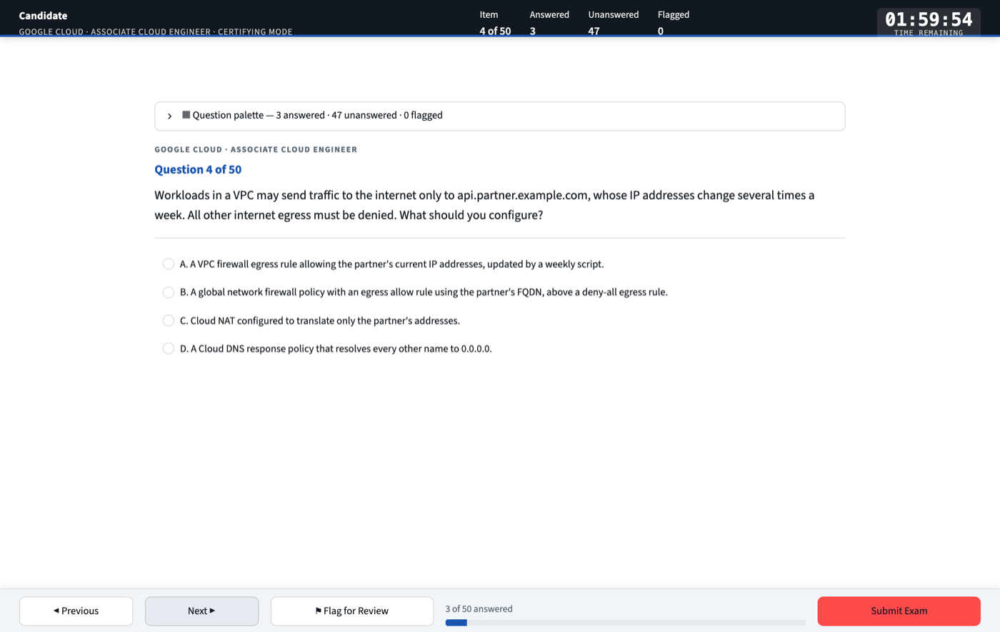

# gcp-ace-simulator

**A timed Google Cloud Associate Cloud Engineer exam on your own machine, and a free theory course, both on the June 2026 exam guide.**

[](https://nirmata78.github.io/gcp-ace-simulator/theory/)
[](LICENSE)
[](https://github.com/nirmata78/gcp-ace-simulator/blob/main/CHANGELOG.md)


Google replaced the Associate Cloud Engineer guide on 30 June 2026: four sections instead of five, weighted
20 / 30 / 30 / 20, with new objectives such as Workforce Identity Federation, Cloud NGFW with secure tags, GPUs vs
TPUs and AI-assisted tooling. This project is built on the new one.

This project has three parts:

- **[A theory course](https://nirmata78.github.io/gcp-ace-simulator/theory/)** that teaches every bullet of the new
  guide, in dependency order, with a recall card per part. It is a website: nothing to install.
- **A question bank of 591 items.** Each one names the guide section, objective and subtopic it tests, explains all
  four options, and links to the documentation behind the answer.
- **An exam shell** that imitates the delivery window: 50 questions sampled at the guide's weights, 120 minutes, a
  question palette, deferred grading, and a PDF score report broken down by objective.

Everything runs locally and all state is plain JSON on disk. No account, no telemetry, no API key.



> Not affiliated with, endorsed by, or sponsored by Google LLC. "Google Cloud" and "Associate Cloud Engineer" are
> trademarks of Google LLC. This is independent study material, not built from real exam questions
> ([how the bank is written](#5--where-the-questions-come-from)). A score here predicts nothing certain about the exam.

---

## 1 · Start

You need Python 3.11 or newer.

```bash
git clone https://github.com/nirmata78/gcp-ace-simulator.git
cd gcp-ace-simulator
python3 -m venv .venv && source .venv/bin/activate
pip install -r requirements.txt
streamlit run app.py                                 # http://localhost:8501
```

`app.py` checks for a network connection at startup and stops if there is none. To study offline:

```bash
ACE_SKIP_NETWORK_CHECK=1 streamlit run app.py
```

**The intended loop:**

1. Read a part of the [theory](https://nirmata78.github.io/gcp-ace-simulator/theory/).
2. Drill it in **Learning mode**, filtered to that part's objectives.
3. Sit a **Certifying** exam, and reread the parts where you scored under 70%.

---

## 2 · Two modes

### Certifying

- **Timing.** 50 questions and 120 minutes, both adjustable. Grading is deferred until you submit. When the timer
  reaches zero the exam submits itself and is marked *time expired*.
- **Sampling at three levels**, each by largest-remainder apportionment, so the counts are exact:
  1. **sections** at the published weights (10 / 15 / 15 / 10);
  2. **objectives** in proportion to their bullet counts;
  3. **subtopics** round-robin, so a 50-item draw covers about 45 distinct subtopics.
- **Unseen questions first.** Questions from earlier attempts are drawn only after the unseen ones in each objective
  run out, so repeated attempts measure knowledge rather than memory of the items.
- **No topic hints.** As in the real delivery window, the item's topic is not shown while you sit.

### Learning

Untimed. Filter by section, objective and subtopic, or tick **Only topics introduced by the June 2026 guide**.
**Check answer** reveals the verdict, the analysis of all four options, the command and the documentation link.

---

## 3 · The blueprint

[`src/blueprint.py`](src/blueprint.py) is the one place the exam structure is written down, transcribed from
[Google's exam guide](https://services.google.com/fh/files/misc/associate_cloud_engineer_exam_guide_english.pdf).

| Section | Weight | Items per 50 | Objectives |
|:--|:--|:--|:--|
| 1 · Setting up a cloud solution environment | ~20% | 10 | 1.1 projects and accounts · 1.2 billing |
| 2 · Planning and implementing a cloud solution | ~30% | 15 | 2.1 compute · 2.2 storage and data · 2.3 networking · 2.4 tooling |
| 3 · Ensuring the successful operation of a cloud solution | ~30% | 15 | 3.1 compute · 3.2 storage and data · 3.3 networking · 3.4 monitoring and logging |
| 4 · Configuring access and security | ~20% | 10 | 4.1 IAM · 4.2 service accounts |

Below the objectives sit the guide's **94 bullets**, 24 of them new in June 2026, and a closed list of **87
subtopics**. **A question must use one of those subtopics**, so anything the guide does not test cannot enter the
bank: validation rejects it on load. Every bullet has at least three questions, and 242 questions sit on bullets the
June 2026 guide introduced.

The bank holds 90 / 220 / 212 / 69 questions by section. That is not the exam's split, and it does not need to be:
the sampler draws by the published weights.

---

## 4 · Working with the bank

```bash
python scripts/kb.py blueprint              # every guide bullet and how many questions teach it (★ = new)
python scripts/kb.py topics --section 3     # objectives and subtopics with counts
python scripts/kb.py list --objective 2.3   # titles for one objective
python scripts/kb.py list --new -v          # only bullets new in June 2026, with summaries
python scripts/kb.py show ace-s2-015        # one question in full (by id or title fragment)
python scripts/kb.py search "secure tag"    # titles, stems, subtopics, tags
python scripts/kb.py stats                  # counts by section/objective, answer-letter spread
python scripts/kb.py check                  # schema, duplicates, per-objective depth, uncovered bullets
```

### Adding questions

Give an `objective` and a `subtopic` from the closed list; the section is derived from the objective.

```json
{
  "title": "Secure tags need the firewall purpose",
  "objective": "2.3",
  "subtopic": "Secure Tags and Service Accounts in Rules",
  "summary": "Only tag keys created with the GCE_FIREWALL purpose can be used in firewall policy rules.",
  "tags": ["secure-tags", "cloud-ngfw"],
  "question": "…",
  "options": { "A": "…", "B": "…", "C": "…", "D": "…" },
  "correct_answer": "B",
  "explanation": {
    "summary": "…",
    "option_breakdown": { "A": "…", "B": "Correct. …", "C": "…", "D": "…" },
    "gcloud_command": "gcloud resource-manager tags keys create …",
    "doc_ref": "https://docs.cloud.google.com/firewall/docs/tags-firewalls-overview"
  }
}
```

```bash
python scripts/kb.py add --file newq.json          # previews, checks overlap, then asks
python scripts/kb.py add --file batch.json --yes   # a JSON list works too
```

**With Claude** (optional; needs `ANTHROPIC_API_KEY`). Give a topic or a rough stem. The prompt gives the model the
closed subtopic list and tells it to write nothing outside the guide. Every candidate is previewed, checked for
overlap and validated before anything is written, and you still have to check the facts.

```bash
python scripts/kb.py add --topic "Cloud NAT and private instances" --count 2
python scripts/kb.py add --stem "How do you restrict egress to one FQDN?" --section 2 --dry-run
```

### Keeping questions unique

Questions **may test the same concept**, because a second scenario on a weak topic is how it gets learned. What they
may not do is repeat each other. `kb.py check`, `kb.py add` and the test suite enforce:

- **Structure.** Ids and titles are unique, the four options are distinct, every option has a rationale, and every
  question sits on the blueprint.
- **A different statement.** No two stems in a section overlap at 0.70 or more (Jaccard overlap of content words).
- **Different answer options.** Two questions with the same correct answer may not share more than two identical
  options, because the second would then be answerable from memory of the first.
- **Coverage.** Every objective has at least three times its share of a 50-item exam.
- **Letter spread.** Every answer letter is correct in 20–30% of questions.

---

## 5 · Where the questions come from

The bank was written for this project with Claude, against the exam guide and Google Cloud's documentation. **No
item is knowingly drawn from a real exam.**

Before publishing, every stem was compared with a well-known public practice-test dump, and every question whose
origin could not be shown to be original was removed, including everything that overlapped. That took out 104
questions from the working bank. A comparison with one dump cannot prove there is no resemblance to any other: **if
you recognise an item, [open an issue](https://github.com/nirmata78/gcp-ace-simulator/issues) and it will go.**

Accuracy is held up by a schema, a link to documentation on every item, and a theory course whose every `gcloud`
command was checked against the SDK. It is not guaranteed: products get renamed and limits change. Fixes are the
[most useful contribution](CONTRIBUTING.md).

---

## 6 · Reports

| Output | Produced by |
|---|---|
| `reports/ACE-report-….pdf` | Every submission: the verdict, section bars against the 70% line, performance by objective, the weakest subtopics and a full item review. It opens in your browser |
| `reports/ACE-retrospective-….pdf` | `scripts/retrospective.py [--attempt ID] [--all]`: a remediation booklet for one attempt, with a summary page and then two pages per missed or flagged item. If you keep your own notes per question in `scripts/retro_content.py` (gitignored), they replace the bank's explanations |
| `reports/ACE-exam-eve-recap-….pdf` | `scripts/recap.py`: one topic per page, for the night before |

Your attempts are recorded in `data/history.json`. That file and `reports/` are gitignored.

---

## 7 · Project layout

```
gcp-ace-simulator/
├── app.py                     # Streamlit exam UI
├── src/
│   ├── blueprint.py           # the June 2026 exam guide: sections, objectives, bullets, subtopics
│   ├── models.py              # schemas, bank persistence, register, duplicate detection
│   ├── exam_engine.py         # three-level sampling, timer, navigation, scoring (no Streamlit imports)
│   └── pdf_generator.py       # score report
├── scripts/
│   ├── kb.py                  # query / add / check / blueprint / reindex
│   ├── check_network.py       # the startup connectivity check
│   ├── retrospective.py       # remediation PDF for one attempt
│   └── recap.py, recap_content.py  # exam-eve recap PDF
├── data/
│   ├── sections/*.json        # the bank, source of truth, one file per guide section
│   └── register.json          # generated index; rebuilt on every write
├── theory/                    # the site: one Markdown page per part
│   ├── pdf/                   # optional local PDF build
│   └── video/                 # sources of a narrated course (the videos are not in the repo)
├── tests/test_simulator.py
└── _config.yml                # GitHub Pages (just-the-docs)
```

All writes are atomic (temp file, then rename), and hand-edits are validated on load. After editing a section file
by hand, run `python scripts/kb.py reindex`.

---

## 8 · Testing

```bash
pytest -q          # 89 tests
```

They cover the schema and blueprint, bank integrity, the exact sampling split, navigation, flags, the timer, deferred
grading and objective scoring, reading older history, PDF generation and the network check. CI runs them on every
pull request, with `kb.py check` and the coverage gate.

---

## Troubleshooting

- **`unknown subtopic` or `belongs to objective …` on load.** A hand-edited or added question is off the blueprint.
  Pick a subtopic that `kb.py topics` lists under the right objective.
- **`duplicate question titles`.** Find them with `grep -h '"title"' data/sections/*.json | sort | uniq -d`.
- **`ANTHROPIC_API_KEY is not set`.** Only LLM authoring needs a key. Use `kb.py add --file` instead.
- **The PDF did not open.** No browser could be launched, which is common over SSH. The results screen shows the path
  and offers a download button.
- **Port 8501 is in use.** Run `streamlit run app.py --server.port 8600`.

---

## Releases

The project uses [semantic versioning](https://github.com/nirmata78/gcp-ace-simulator/blob/main/RELEASE.md). See the [changelog](https://github.com/nirmata78/gcp-ace-simulator/blob/main/CHANGELOG.md) for what changed and for known
limitations, and the [roadmap](https://github.com/nirmata78/gcp-ace-simulator/blob/main/RELEASE.md#roadmap) for what is next, starting with a one-command Docker launch.

## Contributing

Corrections and new questions are welcome. The one rule that cannot bend is **no exam content**:
[`CONTRIBUTING.md`](CONTRIBUTING.md).

## License

[MIT](LICENSE).
